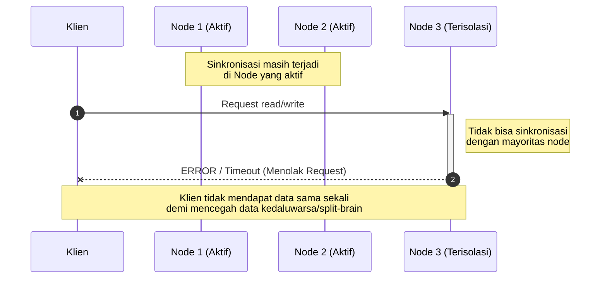
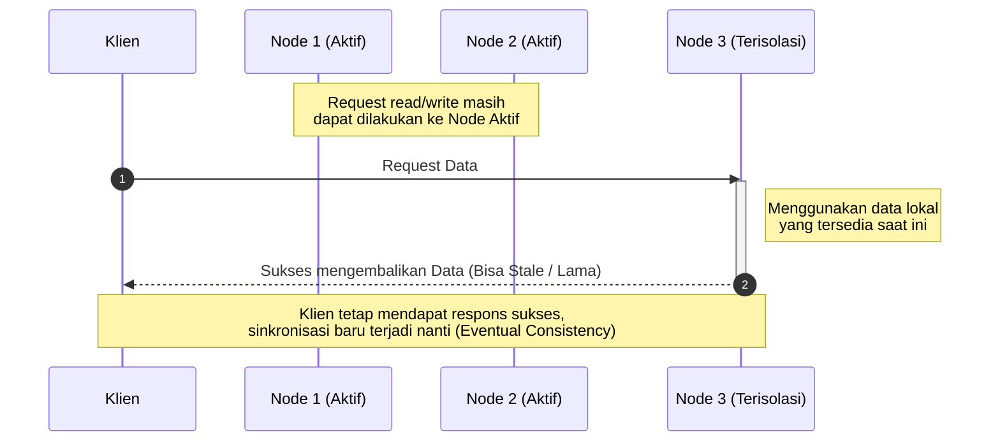

# CAP Theorem

Pada sistem terdistribusi, saat **terjadi network partition** yaitu komunikasi terhadap sebuah node terputus, sehingga sistem **tidak bisa** menjamin _Consistency_ dan _Availability_ sekaligus. Teorema CAP/Brewer ini menyatakan bahwa sebuah sistem data terdistribusi hanya dapat menjamin maksimal dua dari tiga karakteristik utama secara bersamaan: Consistency, Availability, dan Partition Tolerance, CAP **Tidak akan terjadi** ketika semua node terhubung dengan baik (di clusternya) dan berada dalam kondisi sehat dapat di akeses oleh client.

- **Consistency (C)** Setiap _read_ pada sistem terdistribusi akan mengembalikan data terbaru yang ditulis, atau menghasilkan _error_. Tidak ada node yang memberikan data kedaluwarsa. Semua klien melihat data yang persis sama pada waktu yang sama.

- **Availability (A)** Setiap permintaan (_request_) yang diterima oleh node yang tidak mengalami kegagalan (non-failing node) harus menghasilkan respons (bukan _error_ atau _timeout_), terlepas dari apakah data tersebut adalah data terbaru atau lama.

- **Partition Tolerance (P)** **:** Sistem harus tetap beroperasi meskipun terjadi situasi di mana jaringan terputus atau paket data hilang/tertunda di antara sekumpulan node, sehingga sekelompok node terisolasi dari kelompok lainnya. Dengan kata lain,Partition Tolerance adalah sebuah _kondisi darurat_ (faktor eksternal berupa gangguan jaringan).

---

**CP**: Node yang tidak yakin datanya terbaru akan memutuskan **menolak melayani** request baca/tulis dari client.



---

- **AP**: Semua node **tetap melayani**, walaupun datanya mungkin usang atau berbeda (mengorbankan konsistensi).



---

# PACELC

**Teorema PACELC** adalah bentuk penyempurnaan atau perpanjangan dari Teorema CAP yang dibuat oleh Daniel Abadi pada tahun 2012. Jika Teorema CAP hanya melihat kondisi saat terjadi masalah (_partition_), maka PACELC melihat gambaran utuh sistem secara menyeluruh baik dalam kondisi normal maupun saat ada gangguan.

> **"If there is a Partition, how does your system choose between Availability and Consistency? Else (when the system is running normally without partition), how does your system choose between Latency and Consistency?"**

## Bagian Pertama: P - A/C (Saat Terjadi Partisi Jaringan) --> CAP

## Bagian Kedua: E - L/C (Kondisi Normal / Else)

Ini adalah hal baru yang ditambahkan oleh PACELC. Bahkan ketika **tidak ada masalah jaringan** (kondisi normal sehari-hari), sebuah sistem terdistribusi tetap harus memilih antara:

- **Latency (L):** Mengutamakan kecepatan respons. Data direplikasi secara asinkron di belakang layar agar klien langsung mendapat balasan secepat mungkin (risikonya ada jeda waktu di mana data belum seragam).

- **Consistency (C):** Mengutamakan keseragaman data. Sistem menunggu seluruh node selesai menyalin data sebelum membalas klien (risikonya latensi/waktu tunggu menjadi lebih lambat).

# Labs

`docker-compose.yaml` ubah slave jadi peer1 ubah master jadi peer2

```yaml
networks:
  docker_network:
    driver: bridge
volumes:
  mysql_data:
services:
  # Data Replication
  slave:
    image: python:3.12-slim
    container_name: slave
    hostname: slave
    volumes:
      - ./python:/app
    tty: true
    networks:
      - docker_network
  master:
    image: python:3.12-slim
    container_name: master
    hostname: master
    volumes:
      - ./python:/app
    tty: true
    networks:
      - docker_network
  # DISTRIBUTED MUTEX
  app3:
    image: python:3.12-slim
    container_name: app3
    hostname: app3
    volumes:
      - ./python:/app
    tty: true
    networks:
      - docker_network
  app2:
    image: python:3.12-slim
    container_name: app2
    hostname: app2
    volumes:
      - ./python:/app
    tty: true
    networks:
      - docker_network
  app1:
    image: python:3.12-slim
    container_name: app1
    hostname: app1
    volumes:
      - ./python:/app
    tty: true
    networks:
      - docker_network
  # DISTRIBUTED SYSTEM ARCHITECTURE & CLOCK SYNCRONIZATION
  presentation:
    image: python:3.12-slim
    container_name: presentation
    volumes:
      - ./python:/app
    tty: true
    environment:
      - OFFSET=15
      - ROLE=slave
    networks:
      - docker_network
  application:
    image: python:3.12-slim
    container_name: application
    volumes:
      - ./python:/app
    tty: true
    environment:
      - OFFSET=10
      - ROLE=slave
    networks:
      - docker_network
  database:
    image: python:3.12-slim
    container_name: database
    volumes:
      - ./python:/app
    tty: true
    environment:
      - OFFSET=-5
      - ROLE=master
    networks:
      - docker_network
  nginx:
    image: nginx:alpine
    container_name: nginx
    ports:
      - "8080:80"
    volumes:
      - ./stkp_volume/nginx:/usr/share/nginx/html:ro
    networks:
      - docker_network
  mysql:
    image: mariadb:10.11
    container_name: mysql
    environment:
      MARIADB_ROOT_PASSWORD: secretsecret
      MARIADB_USER: admin
      MARIADB_PASSWORD: secretsecret
    volumes:
      - mysql_data:/var/lib/mysql
    networks:
      - docker_network
    tty: true
```

```shell
docker compose up -d peer1 peer
```

`app.py`

```python
import socket, socketserver, threading, time, sys, os, json

NODES = ["peer1", "peer2"]
name = socket.gethostname()
peers = [n for n in NODES if n != name]

DATA_FILE = f"app/p13/data_{name}.json"

if os.path.exists(DATA_FILE):
    try:
        with open(DATA_FILE, "r") as f:
            data = json.load(f)
    except Exception:
        data = {}
else:
    data = {}

def simpan_ke_disk():
    try:
        with open(DATA_FILE, "w") as f:
            json.dump(data, f)
    except Exception as e:
        print(f"[{name}] Gagal menyimpan data ke disk: {e}", flush=True)

IS_PARTITIONED = "--partition" in sys.argv or os.environ.get("PARTITION") == "true"

def terapkan(k, v, ts, asal):
    if k not in data or (ts, asal) > tuple(data[k][1:]):
        data[k] = [v, ts, asal]
        simpan_ke_disk()
        return True
    return False

def kirim(peer, line):
    if IS_PARTITIONED:
        return
    try:
        with socket.create_connection((peer, 3000), timeout=2) as s:
            s.sendall((line + "\n").encode())
    except OSError:
        pass

def repl(rest):
    if IS_PARTITIONED:
        return
    parts = rest.split(" ", 3)
    if len(parts) == 4:
        k, ts, asal, v = parts
        if terapkan(k, v, float(ts), asal):
            print(f"[{name}] [AP Mode] Replikasi sukses: {k}={v} dari {asal}", flush=True)

class Handler(socketserver.StreamRequestHandler):
    def handle(self):
        for line in self.rfile:
            cmd, _, rest = line.decode().strip().partition(" ")
            if cmd == "SET" and " " in rest:
                k, v = rest.split(" ", 1)
                ts = time.time()
                terapkan(k, v, ts, name)
                if not IS_PARTITIONED:
                    for p in peers:
                        threading.Thread(target=kirim, args=(p, f"REPL {k} {ts} {name} {v}")).start()
                    print(f"[{name}] SET {k}={v} berhasil diproses dan disebar.", flush=True)
                    self.wfile.write(b"OK (Disimpan & Disebar)\n")
                else:
                    print(f"[{name}] [PARTITIONED] SET {k}={v} disimpan lokal. Gagal sebar karena terisolasi.", flush=True)
                    self.wfile.write(b"OK (Disimpan secara lokal - Terisolasi / AP Mode)\n")

            elif cmd == "GET":
                item = data.get(rest)
                val = item[0] if item else "(kosong)"
                status = " [Data Lokal / Stale - Terisolasi]" if IS_PARTITIONED else " [Data Sinkron]"
                self.wfile.write(f"{val}{status}\n".encode())

            elif cmd == "REPL":
                if not IS_PARTITIONED:
                    repl(rest)
            elif cmd == "SYNC":
                if not IS_PARTITIONED:
                    sync_data = "".join(f"REPL {k} {ts} {a} {v}\n" for k, (v, ts, a) in data.items())
                    self.wfile.write(sync_data.encode())
            else:
                self.wfile.write(b"ERROR: pakai 'SET key value' atau 'GET key'\n")

def sync(peer):
    while True:
        if IS_PARTITIONED:
            time.sleep(2)
            continue
        try:
            with socket.create_connection((peer, 3000), timeout=2) as s:
                s.sendall(b"SYNC\n")
                s.shutdown(socket.SHUT_WR)
                for line in s.makefile():
                    if not IS_PARTITIONED:
                        line_str = line.strip()
                        if line_str.startswith("REPL "):
                            repl(line_str.split(" ", 1)[1])
            return
        except OSError:
            time.sleep(2)

for p in peers:
    threading.Thread(target=sync, args=(p,), daemon=True).start()

socketserver.ThreadingTCPServer.allow_reuse_address = True
socketserver.ThreadingTCPServer.daemon_threads = True

status_str = " [TERISOLASI / PARTITIONED]" if IS_PARTITIONED else " [NORMAL]"
print(f"[{name}]{status_str} berjalan di port 3000, peers: {peers}", flush=True)
socketserver.ThreadingTCPServer(("", 3000), Handler).serve_forever()
```

`client.py`

```python
import socket, sys

with socket.create_connection(("localhost", 3000)) as s:
    s.sendall((sys.argv[1] + "\n").encode())
    print(s.recv(1024).decode().strip())
```

```shell
docker exec -it peer1 python3 app/p13/app.py
# peer2 normal
docker exec -it peer2 python3 app/p13/app.py
# peer2 dikondisikan partition network
docker exec -it peer2 python3 app/p13/app.py --partition
```

```shell
docker exec -it peer1 python3 app/p13/client.py "SET nama Andi"
docker exec -it peer2 python3 app/p13/client.py "GET nama"
```
