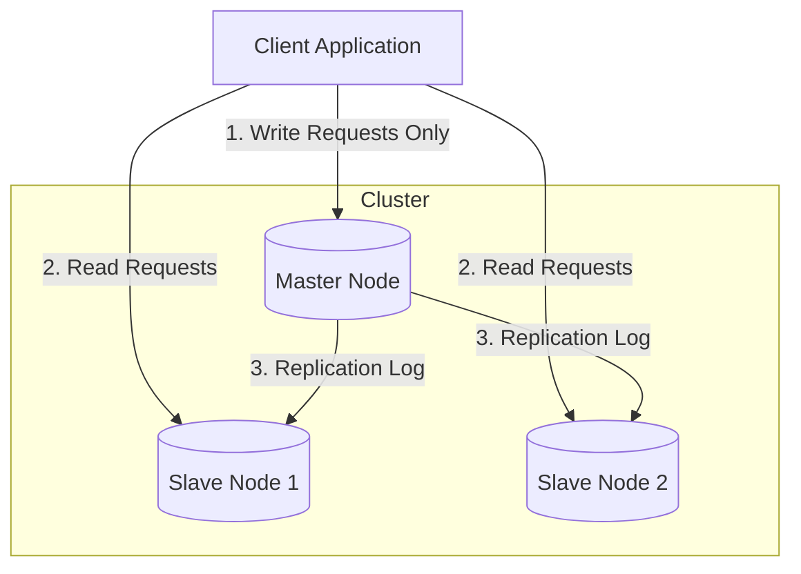
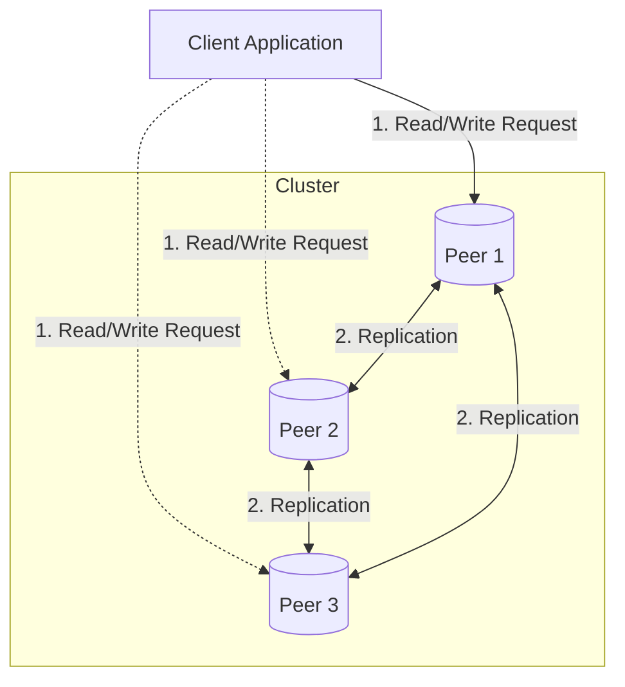
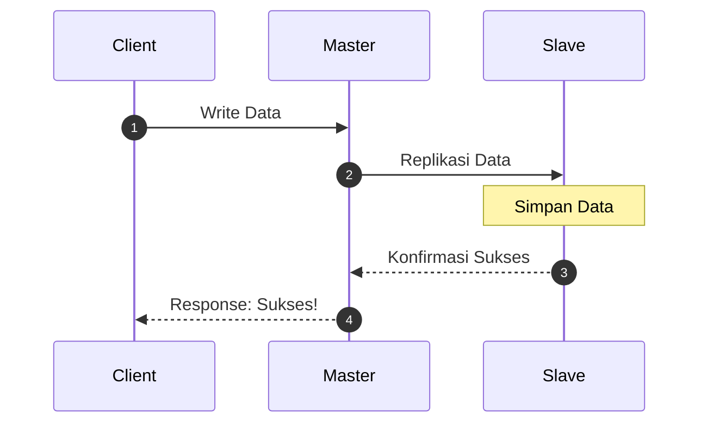
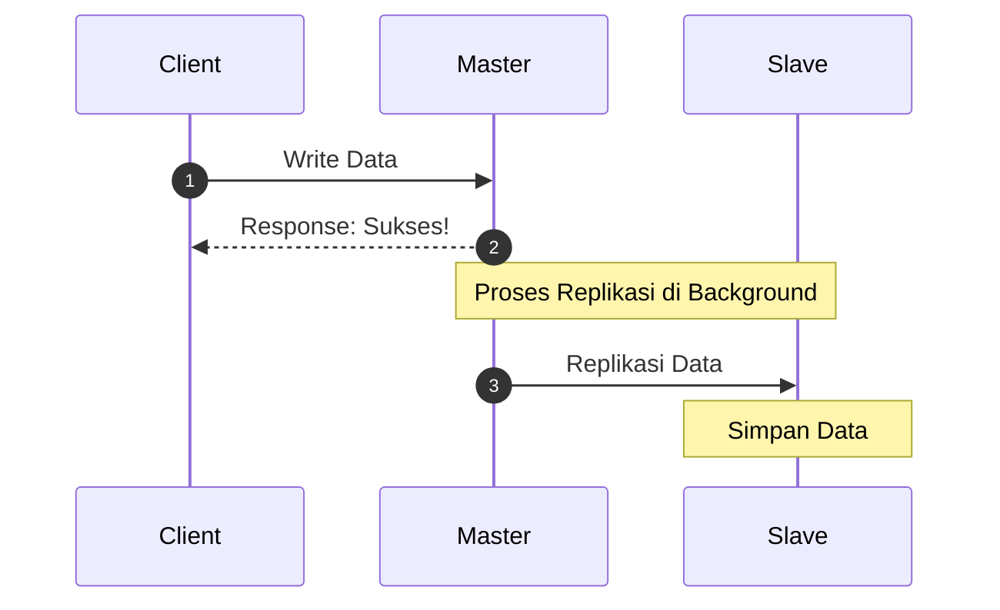

**Replikasi data** adalah proses menyalin dan memelihara data yang sama pada beberapa node (server) berbeda. Tujuannya ada tiga: **ketersediaan tinggi** (_high availability_, sistem tetap hidup saat satu server mati), **ketahanan data** (_durability_, data tidak hilang), dan **performa** (beban baca bisa dibagi ke banyak server).

# Master-Slave Replication

---

Model dengan satu node utama (_master_, kini sering disebut _primary/leader_) dan satu atau lebih node turunan (_slave_, kini _replica/follower_). Semua operasi **tulis** (INSERT, UPDATE, DELETE) hanya diterima oleh master, Master mencatat perubahan ke dalam log, slave membaca log tersebut dan menerapkannya sehingga datanya identik dengan master, operasi **baca** bisa dilayani oleh master maupun slave. **Kelebihan:** Tidak ada konflik penulisan karena hanya satu sumber kebenaran, cocok untuk beban kerja yang didominasi pembacaan (_read-heavy_). **Kekurangan:** Master adalah _single point of failure_ untuk penulisan; jika mati, perlu proses _failover_ (promosi salah satu slave menjadi master), kapasitas tulis terbatas pada satu node, slave bisa tertinggal (_replication lag_), sehingga pembacaan dari slave dapat menghasilkan data lama.

---



---

# Multi-Master / Peer-to-Peer Replication

---

Model di mana **lebih dari satu node** dapat menerima operasi tulis, dan setiap node saling menyinkronkan perubahannya satu sama lain. Klien dapat menulis ke node mana pun, biasanya yang terdekat secara geografis. Perubahan kemudian disebarkan ke node-node lainnya. **Kelebihan:** Tidak ada satu titik kegagalan penulisan; jika satu node mati, node lain tetap menerima tulis, Kapasitas tulis lebih besar dan latensi lebih rendah untuk sistem multi-wilayah (_multi-region_). **Kekurangan:** Jika dua node mengubah data yang sama **pada waktu bersamaan**, terjadi _write conflict_.

---



---

# Replikasi Sinkron vs Asinkron

---

**Sinkron**, Master **harus menunggu konfirmasi** dari Slave bahwa data telah berhasil disimpan, baru kemudian Master memberi tahu Client bahwa proses _write_ sukses.



---

**Asinkron**, Master akan **langsung menjawab sukses** ke Client sesaat setelah data disimpan di lokal Master sendiri. Setelah itu, barulah Master mengirimkan data tersebut ke Slave di latar belakang (_background process_).



---

# Quorum Reads/Writes

_Quorum_ adalah jumlah **minimum** **node** **yang** **harus** **setuju** agar suatu operasi baca atau tulis dianggap sah. Pendekatan ini umum pada sistem tanpa leader tunggal, seperti Amazon Dynamo, Apache Cassandra, dan Riak.

**Aturan emas:**

$\fbox{$W + R > N$}$

- **N** = jumlah total replica yang menyimpan sebuah data

- **W** = jumlah replica yang harus mengonfirmasi **penulisan**

- **R** = jumlah replica yang harus dihubungi saat **pembacaan**

Jika syarat ini terpenuhi, himpunan node yang dipakai untuk menulis dan himpunan node yang dipakai untuk membaca **pasti beririsan** setidaknya pada satu node. Node irisan itu menyimpan data terbaru, sehingga pembaca selalu dapat menemukan nilai terkini.

**Contoh numerik** dengan N = 3:

| Konfigurasi | W   | R   | W + R | Hasil                          |
| :---------- | :-- | :-- | :---- | :----------------------------- |
| Seimbang    | 2   | 2   | 4 > 3 | Konsisten, toleran 1 node mati |
| Tulis cepat | 1   | 3   | 4 > 3 | Tulis ringan, baca berat       |
| Baca cepat  | 3   | 1   | 4 > 3 | Baca ringan, tulis berat       |
| Tidak aman  | 1   | 1   | 2 < 3 | Bisa membaca data usang        |

# Labs

```yaml
networks:
  docker_network:
    driver: bridge
volumes:
  mysql_data:
services:
  # Data Replication
  slave:
    image: python:3.12-slim
    container_name: slave
    hostname: slave
    volumes:
      - ./python:/app
    tty: true
    networks:
      - docker_network
  master:
    image: python:3.12-slim
    container_name: master
    hostname: master
    volumes:
      - ./python:/app
    tty: true
    networks:
      - docker_network
  # DISTRIBUTED MUTEX
  app3:
    image: python:3.12-slim
    container_name: app3
    hostname: app3
    volumes:
      - ./python:/app
    tty: true
    networks:
      - docker_network
  app2:
    image: python:3.12-slim
    container_name: app2
    hostname: app2
    volumes:
      - ./python:/app
    tty: true
    networks:
      - docker_network
  app1:
    image: python:3.12-slim
    container_name: app1
    hostname: app1
    volumes:
      - ./python:/app
    tty: true
    networks:
      - docker_network
  # DISTRIBUTED SYSTEM ARCHITECTURE & CLOCK SYNCRONIZATION
  presentation:
    image: python:3.12-slim
    container_name: presentation
    volumes:
      - ./python:/app
    tty: true
    environment:
      - OFFSET=15
      - ROLE=slave
    networks:
      - docker_network
  application:
    image: python:3.12-slim
    container_name: application
    volumes:
      - ./python:/app
    tty: true
    environment:
      - OFFSET=10
      - ROLE=slave
    networks:
      - docker_network
  database:
    image: python:3.12-slim
    container_name: database
    volumes:
      - ./python:/app
    tty: true
    environment:
      - OFFSET=-5
      - ROLE=master
    networks:
      - docker_network
  nginx:
    image: nginx:alpine
    container_name: nginx
    ports:
      - "8080:80"
    volumes:
      - ./stkp_volume/nginx:/usr/share/nginx/html:ro
    networks:
      - docker_network
  mysql:
    image: mariadb:10.11
    container_name: mysql
    environment:
      MARIADB_ROOT_PASSWORD: secretsecret
      MARIADB_USER: admin
      MARIADB_PASSWORD: secretsecret
    volumes:
      - mysql_data:/var/lib/mysql
    networks:
      - docker_network
    tty: true
```

```python
docker compose up -d master slave
```

`master.py`

```python
import socketserver
data, slaves = {}, []
class Handler(socketserver.StreamRequestHandler):
    def handle(self):
        for line in self.rfile:
            p = line.decode().strip().split(" ", 2)
            if p[0] == "SLAVE":
                self.wfile.write("".join(f"SET {k} {v}\n" for k, v in data.items()).encode())
                slaves.append(self.wfile)
            elif p[0] == "SET" and len(p) == 3:
                data[p[1]] = p[2]
                for s in slaves[:]:
                    try:
                        s.write(f"SET {p[1]} {p[2]}\n".encode())
                    except Exception:
                        slaves.remove(s)
                self.wfile.write(b"OK\n")
                print(f"[MASTER] SET {p[1]}={p[2]}", flush=True)
            elif p[0] == "GET" and len(p) > 1:
                self.wfile.write(f"{data.get(p[1], '(kosong)')}\n".encode())
            else:
                self.wfile.write(b"ERROR: pakai 'SET key value' atau 'GET key'\n")

socketserver.ThreadingTCPServer.allow_reuse_address = True
socketserver.ThreadingTCPServer.daemon_threads = True
print("[MASTER] berjalan di port 3000", flush=True)
socketserver.ThreadingTCPServer(("", 3000), Handler).serve_forever()
```

`slave.py`

```python
import socket, socketserver, threading, time
data = {}
def sync():
    while True:
        try:
            with socket.create_connection(("master", 3000)) as s:
                s.sendall(b"SLAVE\n")
                for line in s.makefile():
                    _, k, v = line.strip().split(" ", 2)
                    data[k] = v
                    print(f"[SLAVE] replikasi {k}={v}", flush=True)
        except OSError:
            pass
        time.sleep(2)

class Handler(socketserver.StreamRequestHandler):
    def handle(self):
        for line in self.rfile:
            p = line.decode().strip().split(" ", 2)
            if p[0] == "GET" and len(p) > 1:
                self.wfile.write(f"{data.get(p[1], '(kosong)')}\n".encode())
            else:
                self.wfile.write(b"ERROR: slave read-only, hanya GET\n")

threading.Thread(target=sync, daemon=True).start()
socketserver.ThreadingTCPServer.allow_reuse_address = True
socketserver.ThreadingTCPServer.daemon_threads = True
print("[SLAVE] berjalan di port 3000", flush=True)
socketserver.ThreadingTCPServer(("", 3000), Handler).serve_forever()
```

`client.py`

```python
import socket, sys
with socket.create_connection(("localhost", 3000)) as s:
    s.sendall((sys.argv[1] + "\n").encode())
    print(s.recv(1024).decode().strip())
```

```shell
docker exec -it master python3 app/p14/master.py # running server master
docker exec -it slave python3 app/p14/slave.py # running server slave
```

```python
# master dapat tulis/baca
docker exec -it master python3 app/p14/client.py "SET nama Andi"
docker exec -it master python3 app/p14/client.py "GET nama"

# slave hanya dapat baca saja
docker exec -it slave python3 app/p14/client.py "GET nama iis"
```

ubah master menjadi peer1 dan slave menjadi peer2

```python
docker compose up -d peer1 peer2
```

`app.py`

```python
import socket, socketserver, threading, time

NODES = ["peer1", "peer2"]
name = socket.gethostname()
peers = [n for n in NODES if n != name]
data = {}

def terapkan(k, v, ts, asal):
    if k not in data or (ts, asal) > data[k][1:]:
        data[k] = (v, ts, asal)
        return True

def kirim(peer, line):
    try:
        with socket.create_connection((peer, 3000), timeout=2) as s:
            s.sendall((line + "\n").encode())
    except OSError:
        pass

def repl(rest):
    k, ts, asal, v = rest.split(" ", 3)
    if terapkan(k, v, float(ts), asal):
        print(f"[{name}] replikasi {k}={v} dari {asal}", flush=True)

class Handler(socketserver.StreamRequestHandler):
    def handle(self):
        for line in self.rfile:
            cmd, _, rest = line.decode().strip().partition(" ")
            if cmd == "SET" and " " in rest:
                k, v = rest.split(" ", 1)
                ts = time.time()
                terapkan(k, v, ts, name)
                for p in peers:
                    threading.Thread(target=kirim, args=(p, f"REPL {k} {ts} {name} {v}")).start()
                self.wfile.write(b"OK\n")
                print(f"[{name}] SET {k}={v}", flush=True)
            elif cmd == "GET":
                self.wfile.write(f"{data.get(rest, ('(kosong)',))[0]}\n".encode())
            elif cmd == "REPL":
                repl(rest)
            elif cmd == "SYNC":
                self.wfile.write("".join(f"REPL {k} {ts} {a} {v}\n" for k, (v, ts, a) in data.items()).encode())
            else:
                self.wfile.write(b"ERROR: pakai 'SET key value' atau 'GET key'\n")

def sync(peer):
    while True:
        try:
            with socket.create_connection((peer, 3000), timeout=2) as s:
                s.sendall(b"SYNC\n")
                s.shutdown(socket.SHUT_WR)
                for line in s.makefile():
                    repl(line.strip().split(" ", 1)[1])
            return
        except OSError:
            time.sleep(2)

for p in peers:
    threading.Thread(target=sync, args=(p,), daemon=True).start()
socketserver.ThreadingTCPServer.allow_reuse_address = True
socketserver.ThreadingTCPServer.daemon_threads = True
print(f"[{name}] berjalan di port 3000, peers: {peers}", flush=True)
socketserver.ThreadingTCPServer(("", 3000), Handler).serve_forever()
```

```python
# semua node dapa tulis baca
docker exec -it peer1 python3 app/p14/client.py "SET nama Andi"
docker exec -it peer1 python3 app/p14/client.py "GET nama"
docker exec -it peer2 python3 app/p14/client.py "SET nama Iwan"
docker exec -it peer2 python3 app/p14/client.py "GET nama"

docker exec -it peer1 python3 app/p14/client.py "SET harga 1000"
docker exec -it peer1 python3 app/p14/client.py "GET harga"
docker exec -it peer2 python3 app/p14/client.py "SET harga 2000"
docker exec -it peer2 python3 app/p14/client.py "GET harga"

```
