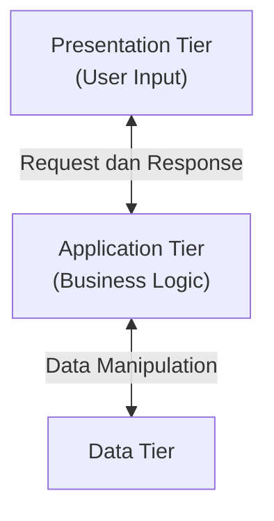
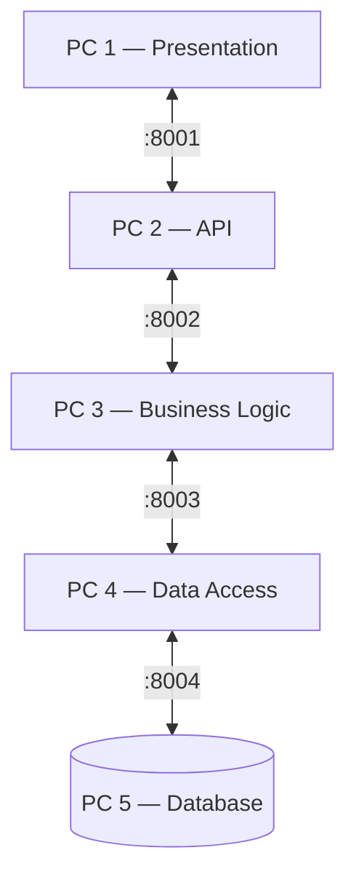

# #9 Distributed System Architectures


[image - Notes](https://app.capacities.io/e288d27f-67f3-4518-a8cf-7caaffd5e145/d15419bf-aac0-4dc9-8e27-6e8839560d92)

# Two-Tier

Arsitektur dua tingkat membagi sistem menjadi dua komponen fisik: klien dan server. Klien berinteraksi langsung dengan server basis data tanpa perantara. Alokasi fungsi:

- Tier 1 (Client): presentation, dan umumnya juga business logic (_fat/thick client_).

- Tier 2 (Server): data management (DBMS).

Contoh: aplikasi desktop (misalnya aplikasi kasir lokal) yang langsung terhubung ke server MySQL/SQL Server.

# Three-Tier

---

Arsitektur tiga tingkat memisahkan sistem menjadi tiga tier fisik yang berbeda, dengan komponen logika aplikasi diisolasi pada tier tengah. Komunikasi bersifat berjenjang: klien tidak boleh mengakses tier data secara langsung. Alokasi fungsi:

- Tier 1 (Presentation tier): antarmuka pengguna (browser, aplikasi mobile).

- Tier 2 (Application/Logic tier): pemrosesan bisnis, validasi, orkestrasi (misalnya server aplikasi atau _web service_).

- Tier 3 (Data tier): DBMS atau penyimpanan data.

Contoh: aplikasi web modern: browser (React) → server aplikasi (Spring Boot/Node.js/Laravel) → basis data (PostgreSQL/MySQL).

---



---

# Multi-Tier

---

Arsitektur multi-tier (n-tier) merupakan generalisasi dari three-tier, di mana fungsi aplikasi dipecah menjadi lebih dari tiga tier fisik. Tier tambahan dapat berupa _API gateway_, _caching layer_, _message broker_, _service_ khusus (otentikasi, pembayaran), _search engine_, atau _reverse proxy/load balancer_. Sistem terdistribusi modern, termasuk arsitektur _microservices_ dan _service-oriented architecture_ (SOA), pada dasarnya mengikuti pola multi-tier.

Contoh: Client → CDN/Load Balancer → API Gateway → Layanan bisnis (beberapa _microservice_) → Cache (Redis) / Message Queue (Kafka) → Basis data (SQL/NoSQL)

---



---

# Peer-to-peer

Semua node (peer) bertindak sebagai client sekaligus server. Tidak ada server pusat.

- **Contoh:** BitTorrent (download file dari banyak pengguna sekaligus).

- **Kelebihan:** Sangat tahan banting (tidak ada pusat yang mati). Biaya murah (user menyumbang bandwidth).

- **Kekurangan:** Sulit diatur (kontrol terdistribusi), keamanan rumit.

# Labs

```yaml
services:
  # DISTRIBUTED MUTEX
  app3:
    image: python:3.12-slim
    container_name: app3
    hostname: app3
    volumes:
      - ./python:/app
    tty: true
    networks:
      - docker_network
  app2:
    image: python:3.12-slim
    container_name: app2
    hostname: app2
    volumes:
      - ./python:/app
    tty: true
    networks:
      - docker_network
  app1:
    image: python:3.12-slim
    container_name: app1
    hostname: app1
    volumes:
      - ./python:/app
    tty: true
    networks:
      - docker_network
  # DISTRIBUTED SYSTEM ARCHITECTURE & CLOCK SYNCRONIZATION
  presentation:
    image: python:3.12-slim
    container_name: presentation
    volumes:
      - ./python:/app
    tty: true
    environment:
      - OFFSET=15
      - ROLE=slave
    networks:
      - docker_network
  application:
    image: python:3.12-slim
    container_name: application
    volumes:
      - ./python:/app
    tty: true
    environment:
      - OFFSET=10
      - ROLE=slave
    networks:
      - docker_network
  database:
    image: python:3.12-slim
    container_name: database
    volumes:
      - ./python:/app
    tty: true
    environment:
      - OFFSET=-5
      - ROLE=master
    networks:
      - docker_network
  nginx:
    image: nginx:alpine
    container_name: nginx
    ports:
      - "8080:80"
    volumes:
      - ./stkp_volume/nginx:/usr/share/nginx/html:ro
    networks:
      - docker_network
  mysql:
    image: mariadb:10.11
    container_name: mysql
    environment:
      MARIADB_ROOT_PASSWORD: secretsecret
      MARIADB_USER: admin
      MARIADB_PASSWORD: secretsecret
    volumes:
      - mysql_data:/var/lib/mysql
    networks:
      - docker_network
    tty: true

networks:
  docker_network:
    driver: bridge

volumes:
  mysql_data:
```

## Three-tier

`database.py`

```python
from xmlrpc.server import SimpleXMLRPCServer

users = {
    1: {"id": 1, "nama": "Andi", "umur": 20},
    2: {"id": 2, "nama": "Budi", "umur": 22},
}

def get_all():
    return list(users.values())

def get_by_id(user_id):
    return users.get(user_id)

def insert(user_id, nama, umur):
    if user_id in users:
        return False

    users[user_id] = {
        "id": user_id,
        "nama": nama,
        "umur": umur
    }
    return True

def delete(user_id):
    if user_id not in users:
        return False

    del users[user_id]
    return True

server = SimpleXMLRPCServer(
    ("0.0.0.0", 8004),
    allow_none=True
)

server.register_function(get_all, "get_all")
server.register_function(get_by_id, "get_by_id")
server.register_function(insert, "insert")
server.register_function(delete, "delete")

print("Database Tier aktif di port 8004", flush=True)
server.serve_forever()
```

`application.py`

```python
from xmlrpc.server import SimpleXMLRPCServer
import xmlrpc.client

database = xmlrpc.client.ServerProxy(
    "http://database:8004/",
    allow_none=True
)

def tampilkan_users():
    return database.get_all()

def cari_user(user_id):
    return database.get_by_id(user_id)

def tambah_user(user_id, nama, umur):
    return database.insert(user_id, nama, umur)

def hapus_user(user_id):
    return database.delete(user_id)

server = SimpleXMLRPCServer(
    ("0.0.0.0", 8000),
    allow_none=True
)

server.register_function(tampilkan_users, "tampilkan_users")
server.register_function(cari_user, "cari_user")
server.register_function(tambah_user, "tambah_user")
server.register_function(hapus_user, "hapus_user")

print("Application Server berjalan di port 8000", flush=True)
server.serve_forever()
```

`presentation.py`

```python
import xmlrpc.client

server = xmlrpc.client.ServerProxy(
    "http://application:8000/",
    allow_none=True
)

while True:
    print("\n=== APLIKASI 3-TIER RPC ===")
    print("1. Tampilkan semua user")
    print("2. Cari user berdasarkan ID")
    print("3. Tambah user")
    print("4. Hapus user")
    print("5. Keluar")

    pilihan = input("Pilih menu: ")

    try:
        if pilihan == "1":
            users = server.tampilkan_users()

            for user in users:
                print(user)

        elif pilihan == "2":
            user_id = int(input("Masukkan ID: "))
            user = server.cari_user(user_id)

            print(user if user else "User tidak ditemukan")

        elif pilihan == "3":
            user_id = int(input("ID: "))
            nama = input("Nama: ")
            umur = int(input("Umur: "))

            hasil = server.tambah_user(user_id, nama, umur)

            if hasil:
                print("User berhasil ditambahkan")
            else:
                print("ID sudah digunakan")

        elif pilihan == "4":
            user_id = int(input("ID yang akan dihapus: "))
            hasil = server.hapus_user(user_id)

            if hasil:
                print("User berhasil dihapus")
            else:
                print("User tidak ditemukan")

        elif pilihan == "5":
            print("Program selesai.")
            break

        else:
            print("Pilihan tidak valid.")

    except ConnectionRefusedError:
        print("Koneksi gagal. Pastikan kedua server aktif.")

    except Exception as e:
        print("Terjadi kesalahan:", e)
```
